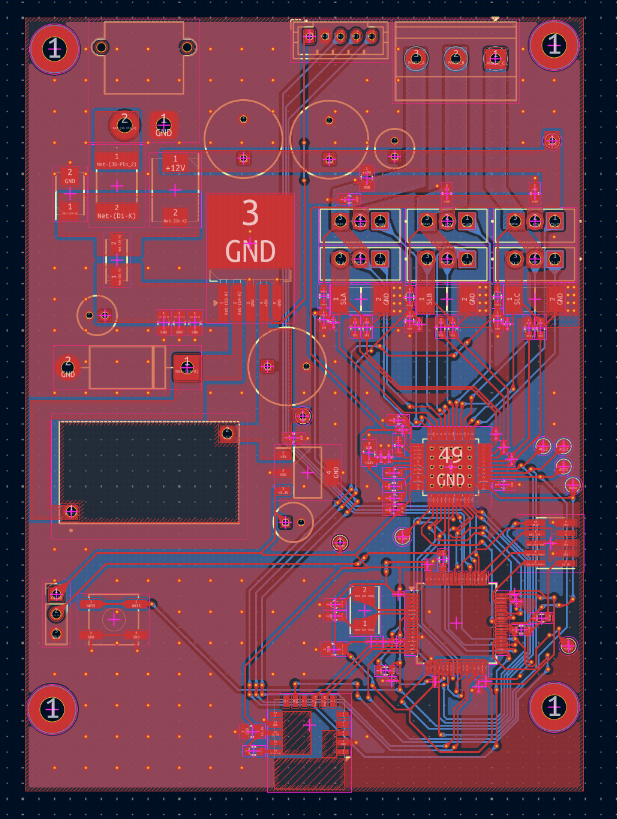
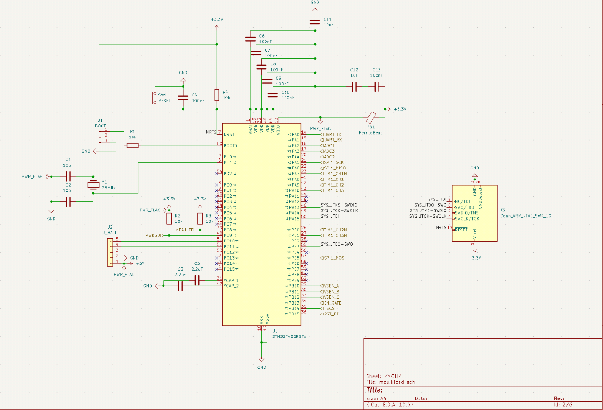
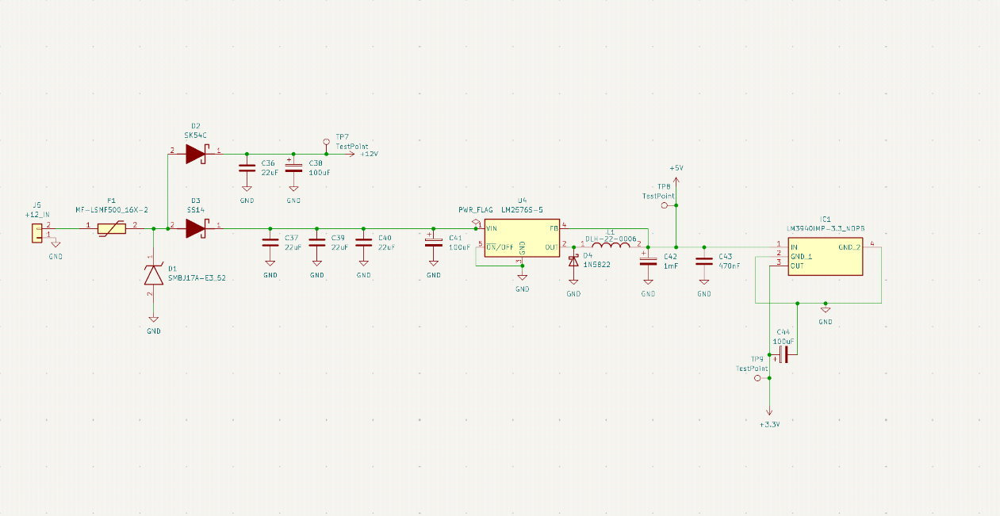

# BLDC Motor Controller Board

A three-phase brushless DC (BLDC) motor controller built around an **STM32F405** microcontroller and a **DRV8305** gate driver. Designed in KiCad for a 12 V supply and 4 A motor current, with a 2x safety margin (8 A) in the power stage.

## Features

- **MCU:** STM32F405RGT6 with a 25 MHz crystal and SWD programming header
- **Motor control:** TIM1 complementary PWM outputs (CH1-3 and CH1N-3N), driver control over SPI, `EN_GATE`, `nFAULT` and `PWRGD` lines
- **Sensing:** shunt-based current sensing (4-wire Kelvin connections), phase voltage sensing (`VSEN_A/B/C`) and a Hall sensor connector
- **Power stage:** three half-bridges with wide power tracks and polygons for high current
- **Power supply:** 12 V input with polyfuse and TVS protection, LM2576 buck converter to 5 V, LM3940 LDO to 3.3 V
- **Wireless:** Bluetooth module

## Schematics

**MCU**

**Power supply**

## Repository layout

| Path | Contents |
|------|----------|
| `project.kicad_pro`, `project.kicad_sch`, `project.kicad_pcb` | KiCad project, top-level schematic and PCB |
| `STM32F405RGT`, `mcu`, `motor_driver`, `power_circuit`, `power_switches`, `bluetooth_module` (`.kicad_sch`) | Schematic sheets |
| `cubemx/` | STM32CubeMX pin and peripheral configuration |
| `Fabrication_files/` | Gerbers and drill files |
| `components/MyComponents.pretty` | Custom footprints |
| `project.csv`, `project-all-pos.csv` | BOM and component placement |

## Opening the project

Open `project.kicad_pro` in KiCad 10 or later.

## Status

Hardware design: schematics and PCB layout.
